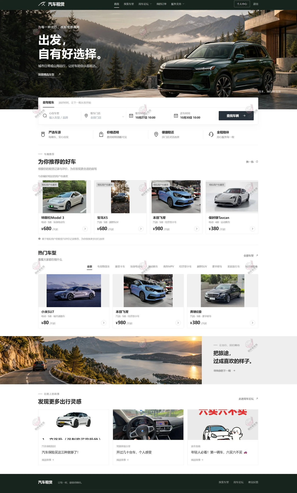
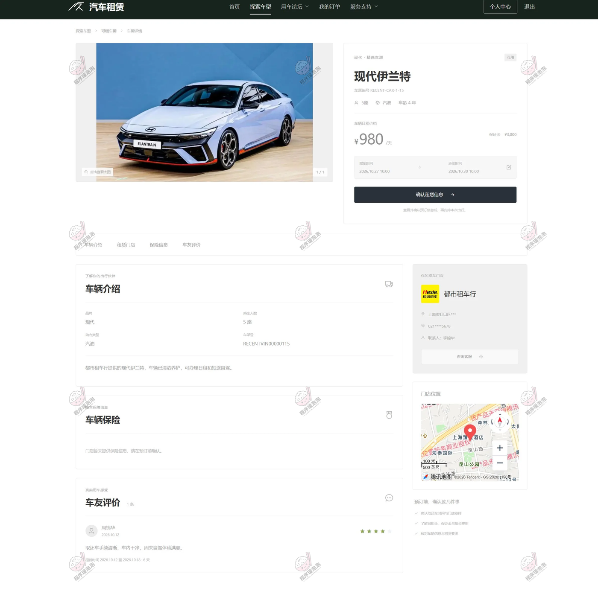
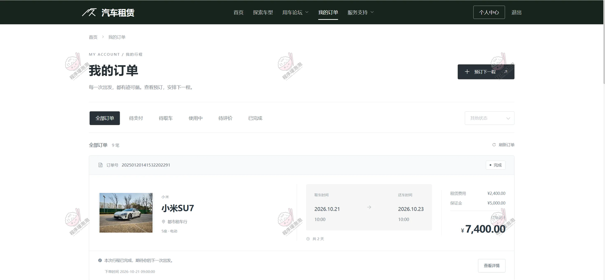
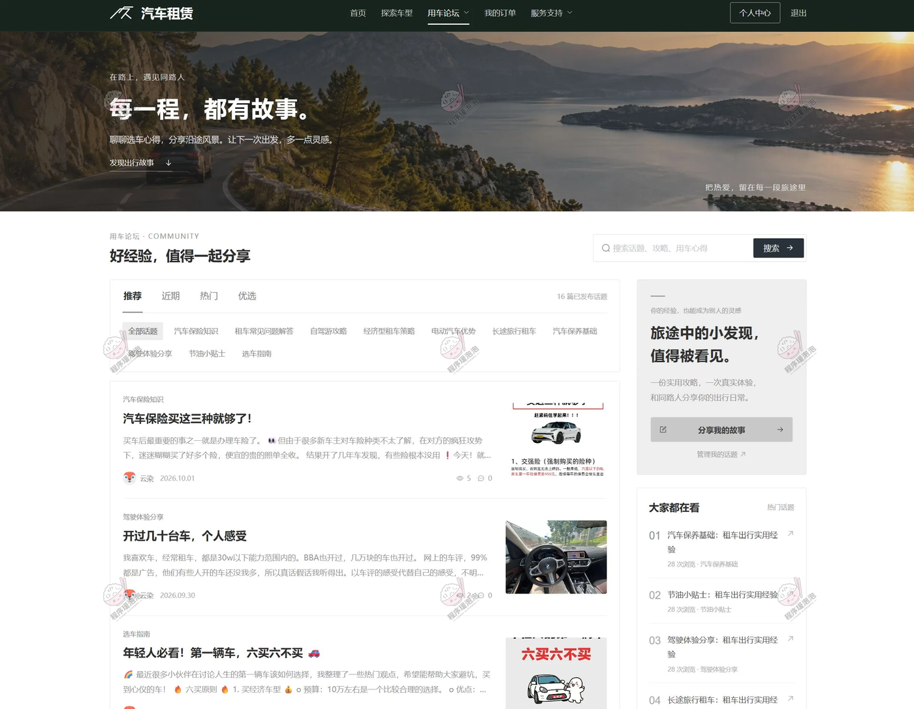
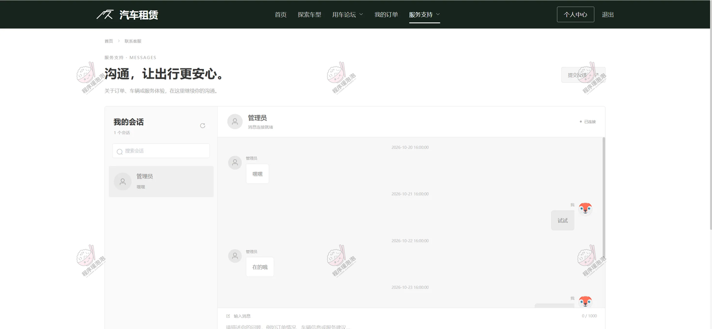
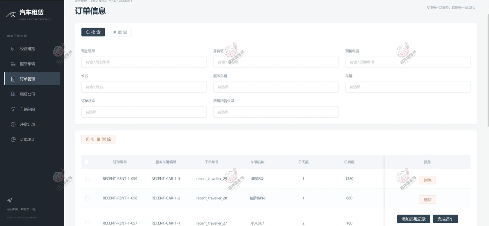
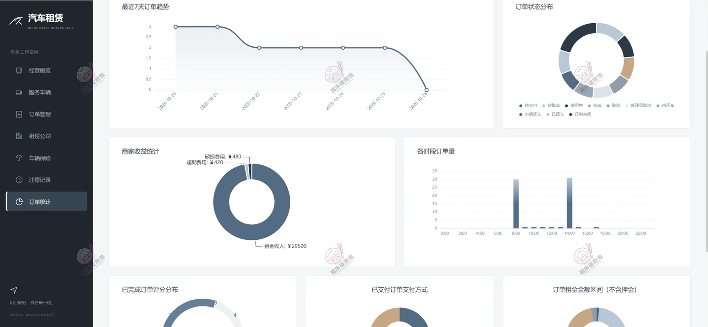
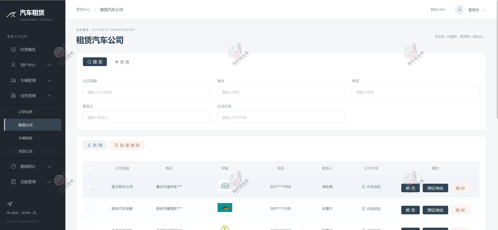
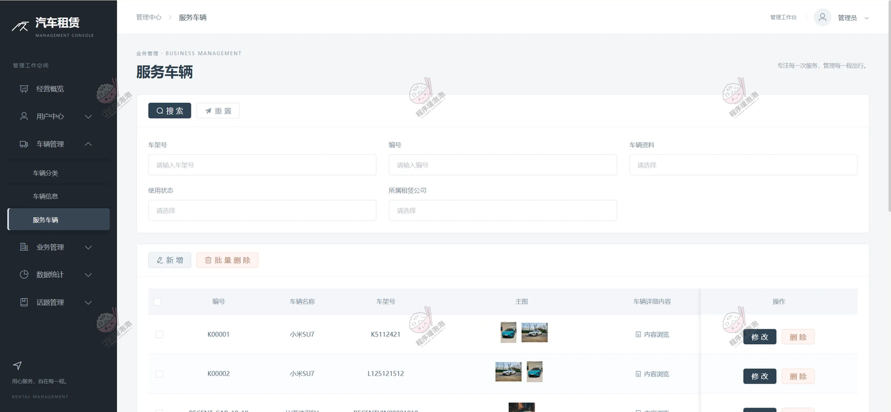
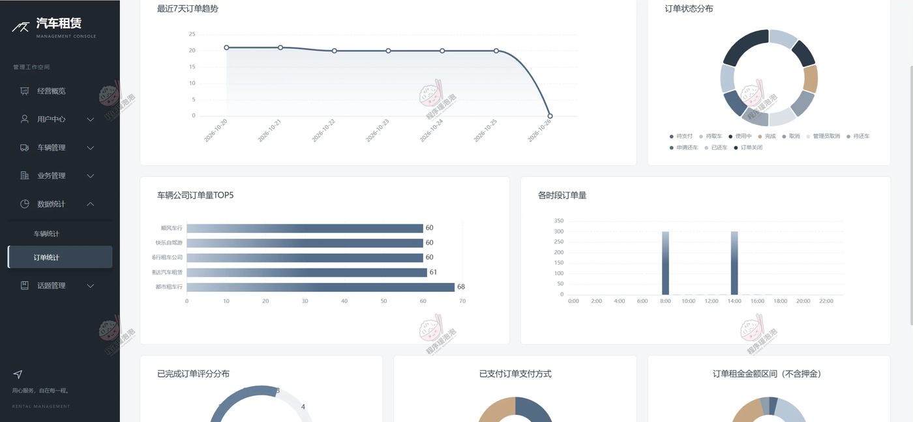

# Vehicles
汽车租赁系统
亮点：协同过滤算法、支付宝沙盒支付、 腾讯地图接入、WebSocket在线沟通、ECharts运营分析、三角色协同、还车费用处理；
角色：用户、商家、管理员；

# 汽车租赁系统

> 基于 Spring Boot 3 + Vue 2 的前后端分离汽车租赁平台，用户 / 商家 / 管理员三角色协同。
> 集成车型加权推荐、话题协同过滤、支付宝沙盒支付、腾讯地图接入、WebSocket 在线沟通、还车费用处理与 ECharts 运营分析。

## 一、项目简介

这是一套覆盖租车全流程的 Web 平台。用户在线选车下单、支付、取车还车；商家维护本公司车辆、处理订单和还车费用；管理员统筹平台资料、公司、车辆和业务数据——三方围绕同一条租赁业务链协作。

系统里几个花心思的地方：（可免费加ai功能）

- **车型加权推荐**：按订单热度 30%、用户评分 50%、服务车辆数量 20% 计算综合分，为首页选车排序提供参考。
- **话题协同过滤推荐**：根据用户浏览记录构建兴趣数据，用余弦相似度算用户相似性，为用车话题做推荐；没有可用结果时随机推荐兜底。
- **租赁业务闭环**：选车 → 选日期 → 下单 → 支付 → 取车 → 使用 → 申请还车 → 还车确认 → 评价，并关联保险、违章和费用信息。
- **支付宝沙盒支付**：接入支付宝沙盒网关，支持创建支付订单与查询支付状态，完整演示租车支付流程。
- **腾讯地图接入**：后台可做地图选点与地址解析，前台车辆详情展示租赁公司门店位置，方便安排取车行程。
- **还车费用处理**：按预计还车时间计算超期费用，支持录入车辆破损费用；商家收益只统计已完成订单的租金和附加费用，押金不计入收入。
- **ECharts 运营分析**：近七天订单趋势、订单状态分布、评分、下单时段、公司订单排行和商家收益，另含支付方式、租金区间、车辆与话题浏览统计。

## 二、技术栈

| 分层 | 技术 |
|---|---|
| 架构 | B/S、MVC、前后端分离，用户 / 商家 / 管理后台三角色协同 |
| 后端 | Java、Spring Boot 3、Spring MVC、MyBatis-Plus、JWT、WebSocket、支付宝沙盒支付 |
| 前端 | Vue 2、Vue CLI、Element UI、Vue Router、Vuex、Axios、ECharts、腾讯地图 |
| 数据存储 | MySQL，覆盖用户、租赁公司、车型、服务车辆、订单、保险、违章和论坛互动数据 |
| 环境 | Windows / IDEA / JDK 17 / Maven / Node.js |

## 三、系统功能

### 3.1 用户端
- 注册登录、个人资料维护和密码修改
- 首页推荐：推荐车型和用车话题，可进入详情查看
- 选车租车：按车型、品牌筛选，查看服务车辆、日租金、保证金和租赁公司
- 地图查看：车辆详情中查看租赁公司位置，安排取车行程
- 在线下单：选租赁起止日期、填写预留信息、查看租金与保证金明细并提交
- 支付与订单：支付宝沙盒支付、我的订单、订单详情及取消订单
- 用车归还：提交还车申请，查看费用明细、违章记录并评价订单
- 用车论坛：发布话题、搜索浏览、收藏、评论互动、查看个人发布内容
- 在线客服与反馈：联系平台客服，提交反馈并查看个人反馈记录

### 3.2 商家端
- 租赁公司管理：查看并维护关联公司资料、联系方式和地图位置
- 服务车辆管理：维护本公司车辆、车架号、车龄、日租金和保证金
- 租赁订单处理：查询本公司订单，办理取消订车、取车确认和还车确认
- 费用处理：还车时录入破损费用，结合超期情况计算违约费用
- 车辆业务记录：维护车辆保险及违章记录
- 经营统计：本公司订单趋势、状态、评分与租赁收入构成
- 账户维护：修改个人资料、修改密码及退出登录

### 3.3 管理员端
- 用户管理：用户信息维护、角色设置、条件查询及数据导出
- 车辆资料管理：车辆分类、品牌、车型、座位数、动力类型及图片维护
- 租赁业务管理：租赁公司、服务车辆、日租金、保证金、保险及违章记录维护
- 订单管理：订单查询、取消订车、取车确认、还车确认及超期和破损费用处理
- 用车论坛管理：话题分类、内容维护、审核、推荐设置及浏览统计
- 客户服务：在线会话、用户反馈信息查看与处理
- 数据看板：订单总量、今日订单、进行中订单、租赁收入、订单趋势、状态分布、支付方式和租金区间分析

## 四、系统截图

以下选取 10 张代表性截图，按三个角色分别展示。源文档首图为登录入口页，未提供独立的系统总览图。

### 4.1 用户端

**首页** —— 顶部租车搜索条（地点 / 取还车时间），下方为按综合分排序的推荐车型和热门车型，底部是按浏览兴趣推荐的用车话题。

**车辆详情** —— 车型图片、日租金与保证金、取还车日期和下单入口；下方含车辆介绍、车友评价，右侧嵌入腾讯地图展示门店位置。

**我的订单** —— 按待支付 / 待取车 / 使用中 / 待评价 / 已完成分类，订单卡片展示车型、租赁时间、租金与保证金明细。

**用车论坛** —— 话题分类标签与话题列表，配合热门话题榜和"分享我的故事"入口，是协同过滤推荐落地的地方。

**联系客服** —— 会话列表 + 聊天窗口，用户与平台客服在线沟通租车问题，对应 WebSocket 消息收发。

### 4.2 商家端

**订单管理** —— 按驾车证 / 车辆 / 订单状态等条件筛选本公司订单，支持添加违章记录、完成还车等操作，串起还车与费用处理流程。

**订单统计** —— 近七天订单趋势、状态分布、商家收益统计（租金 / 超期费用 / 破损费用）、客流时段和支付方式分布，押金不计入收入。

### 4.3 管理员端

**租赁公司** —— 维护租赁公司资料，支持绑定地址（地图选点），是平台多商家场景的基础数据。

**服务车辆** —— 统筹全平台服务车辆的车架号、编号、车辆资料和使用状态。

**订单统计** —— 在订单趋势与状态分布之外，额外提供车辆公司订单量 TOP5 排行，体现管理员跨公司的运营视角。

---

文档展示 10 张截图，需要了解更多，请联系我。
